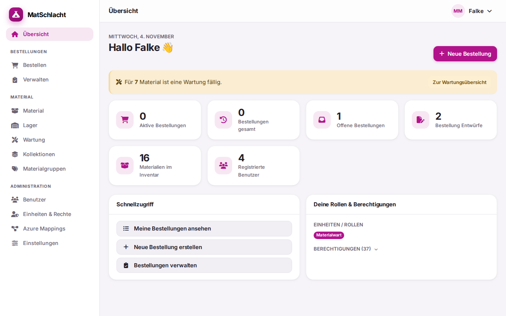

# MatSchlacht

[](https://github.com/Vento-Nuenenen/MatSchlacht/actions/workflows/tests.yml)
[](https://github.com/Vento-Nuenenen/MatSchlacht/actions/workflows/lint.yml)
[](phpstan.neon)
[](https://github.com/Vento-Nuenenen/MatSchlacht/actions/workflows/tests.yml)

> [!WARNING]
> **Under Construction:** MatSchlacht ist in aktiver Entwicklung. Funktionen und Datenbankschema können sich noch ändern. Der Einsatz in Produktion erfolgt auf eigenes Risiko.

MatSchlacht ist eine Web-App zur Materialverwaltung, entstanden für die Pfadi Nünenen. Sie richtet sich an Pfadi-Abteilungen und ähnliche Vereine mit eigenem Materiallager: Material erfassen, für Lager und Anlässe bestellen, bereitstellen und wieder zurücknehmen. Die App läuft auf Smartphone, Tablet und Desktop, im hellen und im dunklen Modus.



## Funktionen

- **Bestellungen:** vom Entwurf über Bestätigung und Ausgabe bis zur Rückgabe, mit Auftrags-, Retouren- und Packliste als PDF
- **Verfügbarkeit:** Eingereichte, bestätigte und ausgegebene Bestellungen reservieren ihr Material für den Zeitraum; Material in Reparatur zählt nicht als verfügbar
- **Material:** Materialgruppen, Kollektionen, Inhaltslisten und Datei-Anhänge
- **Lagerhaltung:** Lagerort › Lagerraum › Lagerregal › Regalebene › Lagerplatz mit Bestand pro Platz und druckbaren Etiketten mit QR-Code
- **Beschaffung und Wartung:** Beschaffungen mit Belegen, Wartungsprotokoll, Intervalle und Erinnerungsmails
- **Anmeldung:** Passwort, Microsoft Azure und Hitobito (z. B. MiData), mit Rollen und Berechtigungen pro Einheit
- **Dateispeicher:** Amazon S3 und S3-kompatible Dienste, lokaler Server, SFTP, FTP, SharePoint/OneDrive, Nextcloud, Dropbox und Google Drive

Die meisten Funktionen sind Komponenten, die sich unter **Einstellungen** ein- und ausschalten und konfigurieren lassen. Dort werden auch die Hauptfarbe und der Dateispeicher gewählt. Lagerhaltung, Beschaffung und Wartung sind standardmässig aus.

Die [Funktionsübersicht](docs/funktionen.md) zeigt alles im Detail und mit Screenshots.

## Schnellstart

Du brauchst PHP 8.4 oder neuer, Composer, Node.js 24 und PostgreSQL.

```bash
composer install
npm install
cp .env.example .env
php artisan key:generate
```

In der `.env` die Datenbank eintragen, danach:

```bash
php artisan migrate --seed
npm run build
composer dev
```

> [!CAUTION]
> Der Seeder legt für die lokale Entwicklung das Konto `admin@example.com` mit dem Passwort `password` an. Auf einem öffentlich erreichbaren Server darf dieses Konto nicht existieren.

## Dokumentation

- [Funktionen](docs/funktionen.md)
- [Installation](docs/installation.md)
- [Betrieb](docs/betrieb.md)
- [Entwicklung](docs/entwicklung.md)
- [Verwendete Pakete](docs/pakete.md)

## Mitwirken

Fehler und Ideen sind als [GitHub Issue](https://github.com/Vento-Nuenenen/MatSchlacht/issues) willkommen. Vor einem Pull Request bitte `composer test` ausführen und für geändertes Verhalten Tests ergänzen.

## Lizenz

MatSchlacht steht unter der [MIT-Lizenz](LICENSE). Für die verwendeten Pakete gelten die in der [Paketliste](docs/pakete.md) genannten Lizenzen.
