# Funktionen

Diese Seite zeigt die wichtigsten Funktionen von MatSchlacht. Alle Screenshots enthalten Demodaten.

- [Übersicht](#übersicht)
- [Bestellungen](#bestellungen)
- [Material](#material)
- [Kollektionen](#kollektionen)
- [Lagerhaltung](#lagerhaltung)
- [Beschaffung und Wartung](#beschaffung-und-wartung)
- [Benutzer und Einheiten](#benutzer-und-einheiten)
- [Einstellungen](#einstellungen)
- [Smartphone und dunkler Modus](#smartphone-und-dunkler-modus)

## Übersicht

Nach der Anmeldung zeigt die Übersicht die wichtigsten Zahlen, fällige Wartungen und Schnellzugriffe.

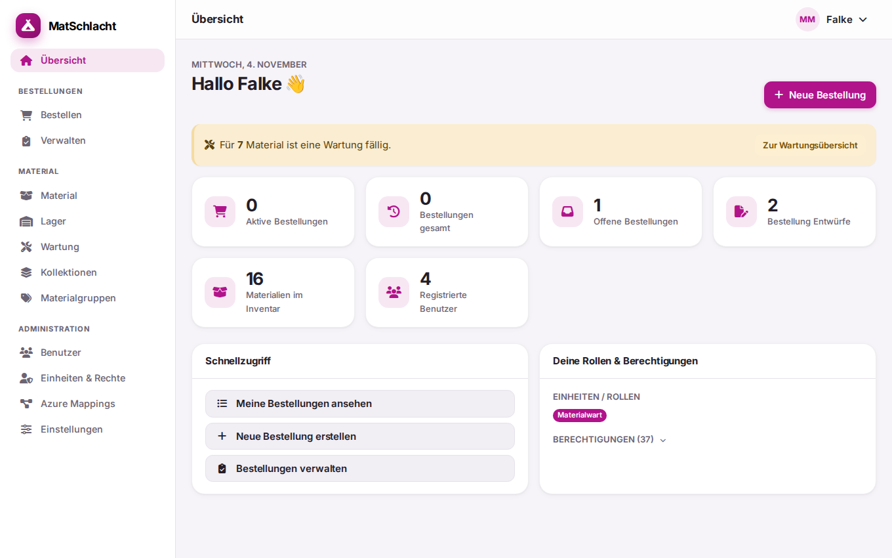

## Bestellungen

### Material bestellen

Eine Bestellung gehört zu einem Anlass, einer Einheit und einem Zeitraum. Das Material lässt sich einzeln wählen oder als Kollektion hinzufügen. Die Bestellung kann als Entwurf gespeichert oder direkt abgeschickt werden.

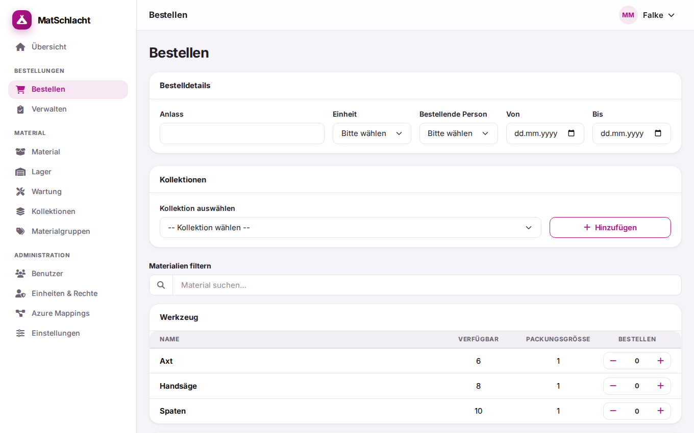

### Ablauf

Jede Bestellung durchläuft diese Status:

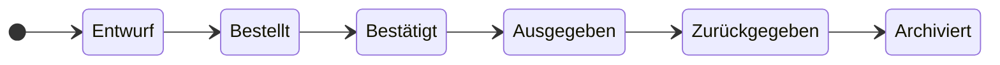

Jeder Schritt bis zur Rückgabe lässt sich rückgängig machen. Eine Bestellung, die noch nicht ausgegeben wurde, kann direkt archiviert und damit storniert werden.

| Status | Bedeutung | Reserviert Material |
| --- | --- | --- |
| Entwurf | Noch in Arbeit, die bestellende Person kann sie bearbeiten und löschen | Nein |
| Bestellt | Abgeschickt, wartet auf die Bestätigung | Ja |
| Bestätigt | Angenommen, die Auftragsliste steht als PDF bereit | Ja |
| Ausgegeben | Material ist draussen, die Retourenliste steht als PDF bereit | Ja |
| Zurückgegeben | Material ist zurück, die Rückgabemengen sind erfasst | Nein |
| Archiviert | Abgeschlossen oder storniert | Nein |

### Bestellungen verwalten

Unter **Verwalten** sind alle aktiven Bestellungen nach Status gruppiert.

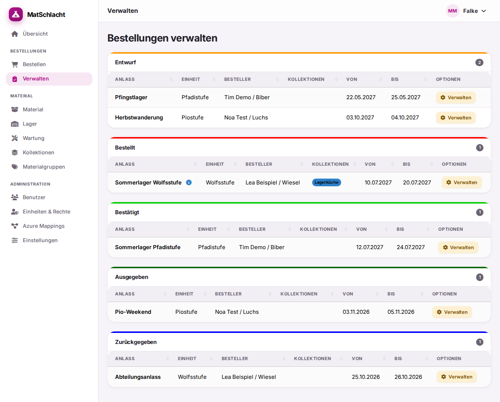

In der Detailansicht lassen sich die Bestellung bearbeiten, der Status wechseln und PDFs erzeugen. Es werden nur die Aktionen angezeigt, die im aktuellen Status möglich sind.

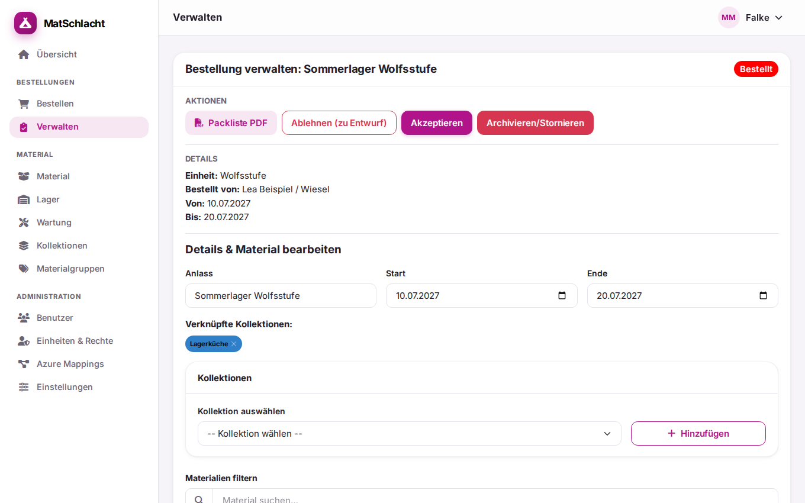

### Verfügbarkeit

Bestellte, bestätigte und ausgegebene Bestellungen reservieren ihr Material für ihren Zeitraum. Material in Reparatur zählt nicht als verfügbar. Reicht der Bestand nicht aus, lehnt die App die Bestellung mit einer Meldung ab.

### Mail-Benachrichtigungen

Die App kann bei neuen Bestellungen und beim Wechsel auf **Bestellt** oder **Bestätigt** Mails verschicken. Das lässt sich unter **Einstellungen** anpassen.

## Material

Material ist in Materialgruppen eingeteilt. Die Liste zeigt Bestand, Packungsgrösse und die Menge in Reparatur. Für ausgewähltes Material lassen sich Etiketten drucken.

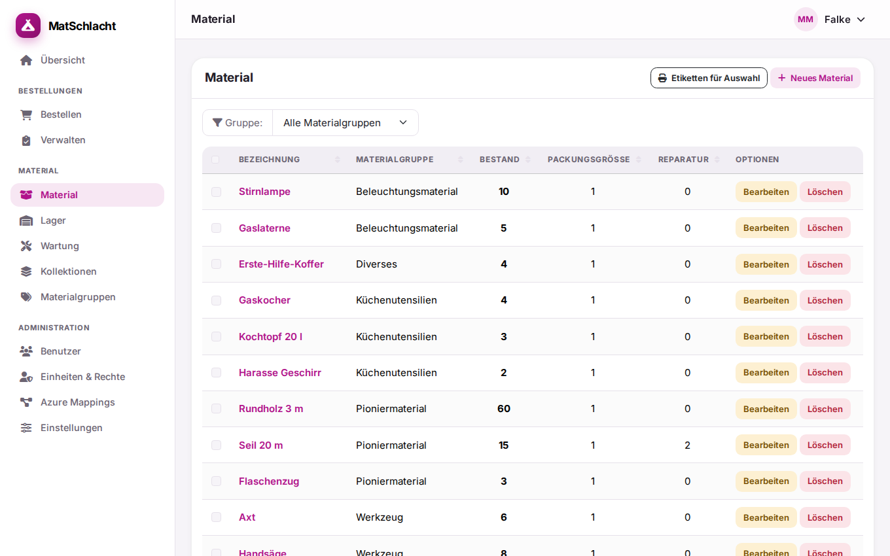

Die Detailseite fasst alles zu einem Material zusammen: Lagerplätze, Wartung und Beschaffungen. Dazu kommen je nach aktivierten Komponenten Inhaltslisten und Datei-Anhänge.

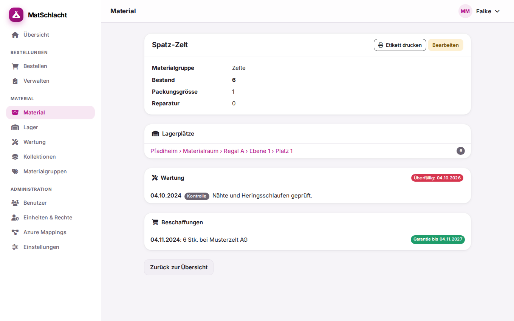

## Kollektionen

Kollektionen sind vordefinierte Material-Sets, zum Beispiel eine Lagerküche. Beim Bestellen lassen sie sich als Ganzes hinzufügen.

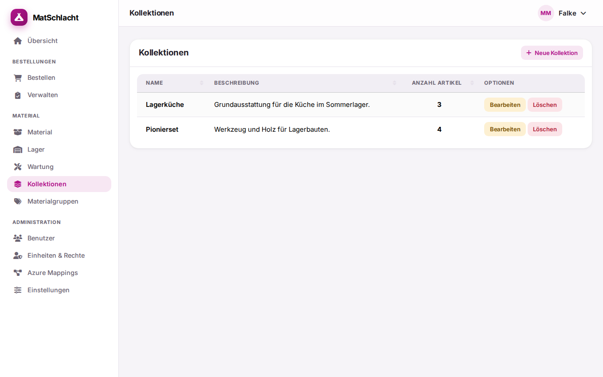

## Lagerhaltung

Das Lager ist in fünf Ebenen aufgebaut: Lagerort › Lagerraum › Lagerregal › Regalebene › Lagerplatz. Der Bestand wird pro Lagerplatz geführt. Hat ein Material Lagerplätze, ergibt sich sein Bestand aus deren Summe. Für Lagerplätze und Material lassen sich Etiketten mit QR-Code drucken.

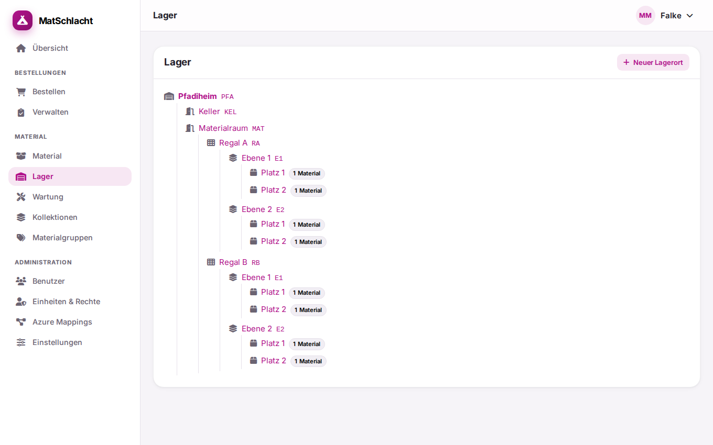

Die Lagerhaltung ist standardmässig ausgeschaltet.

## Beschaffung und Wartung

Beschaffungen werden pro Material erfasst, mit Datum, Menge, Lieferant, Preis, Beleg-Nummer und Garantie.

Das Wartungsprotokoll hält Kontrollen, Reinigungen und Reparaturen fest. Mit einem Wartungsintervall erscheint Material in der Wartungsübersicht, sobald eine Wartung ansteht. Material mit Intervall, das noch nie gewartet wurde, gilt sofort als fällig. Fällige Wartungen lassen sich wöchentlich per Mail melden.

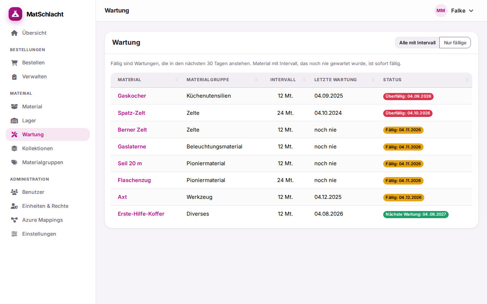

Beschaffung und Wartung sind standardmässig ausgeschaltet.

## Benutzer und Einheiten

Die Anmeldung läuft über Passwort, Microsoft Azure oder Hitobito (z. B. MiData).

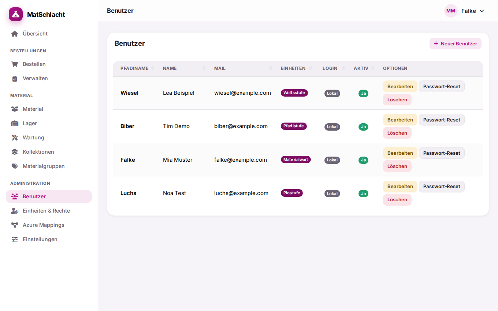

Einheiten sind zugleich Rollen: Sie bestimmen, was ihre Mitglieder dürfen.

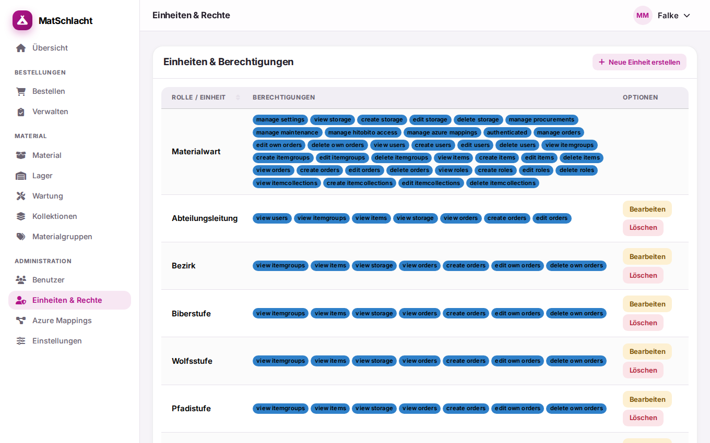

## Einstellungen

Die meisten Funktionen sind Komponenten, die sich unter **Einstellungen** ein- und ausschalten und konfigurieren lassen. Dort werden auch die Hauptfarbe, die Anmeldemethoden und der Dateispeicher gewählt.

Als Dateispeicher stehen Amazon S3 und S3-kompatible Dienste, der lokale Server, SFTP, FTP, SharePoint/OneDrive, Nextcloud, Dropbox und Google Drive zur Verfügung.

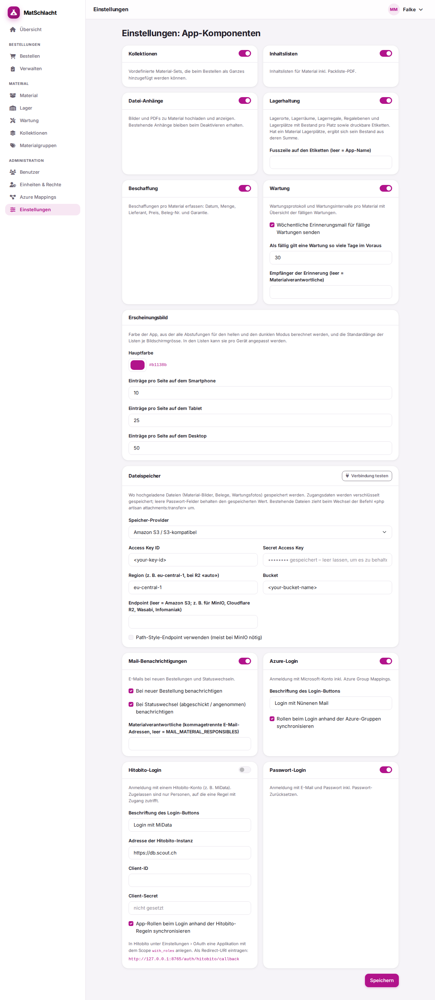

## Smartphone und dunkler Modus

Die App läuft auf Smartphone, Tablet und Desktop. Auf dem Smartphone erfolgt die Navigation über eine Leiste am unteren Rand.

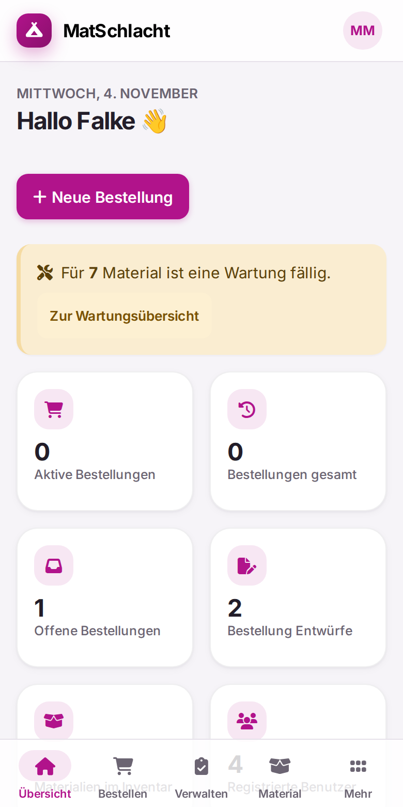

Die Darstellung ist hell, dunkel oder automatisch nach der Einstellung des Geräts.

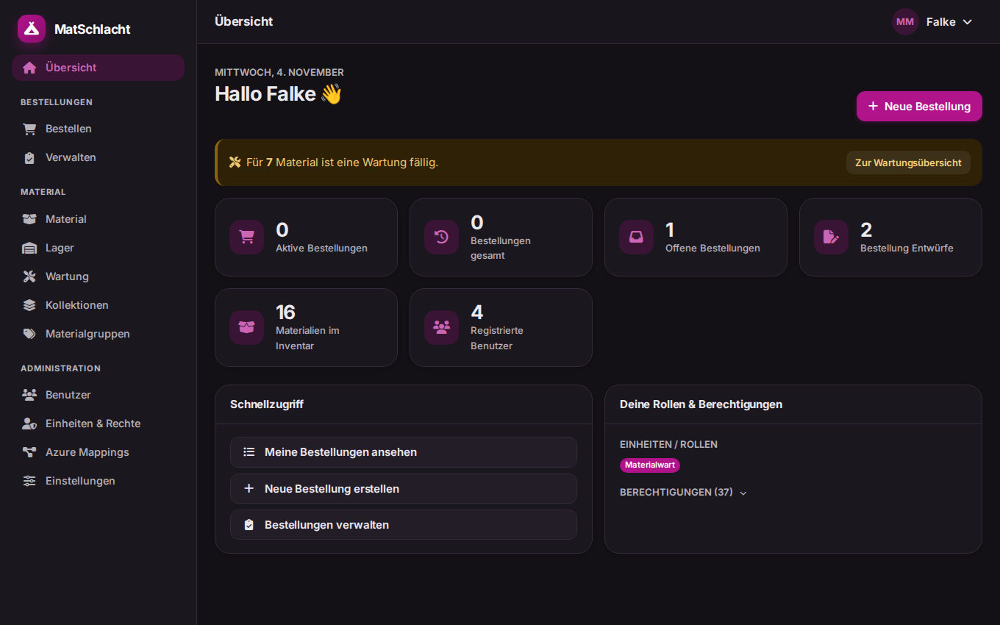
